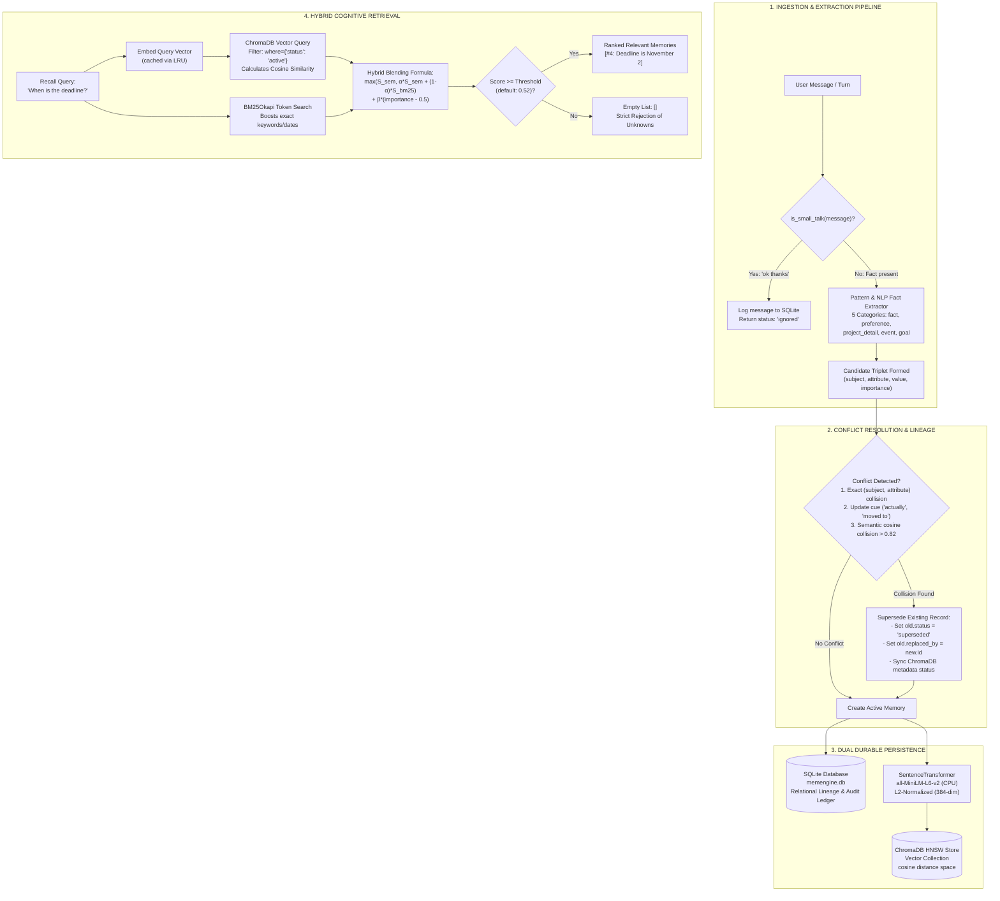

```text
========================================================================================
       __  ___                 ______             _            
      /  |/  /___  ____ ___   / ____/___  ____ _ (_)___  ___   
     / /|_/ / _ \/ __ `__ \  / __/ / __ \/ __ `// / __ \/ _ \  
    / /  / /  __/ / / / / / / /___/ / / / /_/ // / / / /  __/  
   /_/  /_/\___/_/ /_/ /_/ /_____/_/ /_/\__, //_/_/ /_/\___/   
                                       /____/                  
       Local-First Cognitive Memory Engine for AI Chatbots • 100% Offline
========================================================================================
```

# 🧠 MemEngine

<div align="center">

**A High-Performance, Local-First Cognitive Memory Engine for AI Chatbots**  
*Extracts useful facts • Supersedes conflicting knowledge • Preserves audit lineage • Rejects unknown queries with zero hallucination*

[](https://python.org)
[](https://fastapi.tiangolo.com)
[](https://www.trychroma.com)
[](https://huggingface.co/sentence-transformers/all-MiniLM-L6-v2)
[](https://streamlit.io)
[](https://github.com/astral-sh/uv)
[](https://docs.pytest.org)
[](#-evaluation-benchmark-suite)
[](LICENSE)

[Key Features](#-key-features) •
[Quick Demo](#-canonical-4-turn-walkthrough) •
[Architecture](#-system-architecture) •
[Installation & Setup](#-getting-started) •
[Web Interfaces](#-interactive-web-consoles) •
[REST API](#-rest-api-reference) •
[Benchmarks](#-evaluation-benchmark-suite) •
[Architectural Deep Dive](#-architectural-deep-dive--design-questions)

</div>

---

> [!NOTE]
> **100% Offline & Zero Paid APIs**: MemEngine runs entirely on commodity laptop hardware. Embeddings are generated locally on CPU using `all-MiniLM-L6-v2`. Facts are durably tracked in an embedded SQLite database and indexed into an embedded ChromaDB vector collection. **No OpenAI API tokens, no monthly cloud bills, and zero data leakage.**

---

## ⚡ Key Features

| Capability | How MemEngine Solves It |
| :--- | :--- |
| **Intelligent Small Talk Filter** | Deterministically classifies conversational pleasantries (*"ok thanks"*, *"sounds good"*, *"hello"*) and ignores them from vector memory storage while logging messages for context. |
| **Structured Fact Extraction** | Normalizes natural language into canonical `(subject, attribute, value)` triplets across 5 memory types (`fact`, `preference`, `project_detail`, `event`, `goal`). |
| **Deterministic Conflict Resolution** | Detects updates and contradictions using subject-attribute collision and linguistic update cues (*"actually"*, *"moved to"*, *"switched to"*). Supersedes old facts and links them via `replaced_by` rather than destructively deleting them. |
| **Calibrated Hybrid Retrieval** | Blends dense semantic vector search (ChromaDB cosine similarity) with lexical keyword matching (BM25Okapi) and importance scores: $\max(S_{\text{sem}}, \alpha S_{\text{sem}} + (1-\alpha)S_{\text{bm25}}) + \beta(\text{importance} - 0.5)$. |
| **Strict Unknown Rejection** | Calibrated similarity threshold ($0.52$) guarantees queries about unmentioned topics (*"What is the user's favourite food?"*) strictly return an empty list `[]` instead of hallucinating unrelated memories. |
| **Ultra-Low Latency on CPU** | Measures **~0.12 ms** p50 ingestion latency and **~1.53 ms** p50 hybrid recall latency with over **400 ops/sec** throughput on a standard laptop CPU. |
| **Dual User Interfaces** | Includes a full-featured **Streamlit Web Console** with a 1-click benchmark evaluator and a glassmorphic **Dark-Mode FastAPI Web Dashboard**. |

---

## 🚀 Canonical 4-Turn Walkthrough

MemEngine was engineered to solve the real-world lifecycle of conversational memory. Over multiple conversation turns, the engine maintains factual accuracy and excludes outdated information:

```python
from app.schemas import IngestRequest, RecallRequest
from app.updates import get_conflict_resolver
from app.retrieval import get_recall_engine

resolver = get_conflict_resolver()
recall_engine = get_recall_engine()

# 1. Ingest factual knowledge
resolver.process_ingest_request(IngestRequest(message="I use Arch Linux."))
resolver.process_ingest_request(IngestRequest(message="I'm building a Next.js app."))
resolver.process_ingest_request(IngestRequest(message="My project deadline is October 15."))

# 2. Ingest an update/correction that contradicts an earlier fact
resolver.process_ingest_request(IngestRequest(message="Actually, the deadline moved to November 2."))

# 3. Recall queries
# Query A: Direct fact recall
q1 = recall_engine.recall(RecallRequest(query="What OS does the user use?"))
print(q1.memories[0].text)
# -> "User uses Arch Linux." (Score: 0.74, Status: active)

# Query B: Updated fact recall (October 15 is strictly excluded; November 2 is returned)
q2 = recall_engine.recall(RecallRequest(query="When is the project deadline?"))
print(q2.memories[0].text)
# -> "Deadline is November 2." (Score: 0.76, Status: active)

# Query C: Negative query for unmentioned facts
q3 = recall_engine.recall(RecallRequest(query="What is the user's favourite food?"))
print(q3.memories)
# -> [] (Safely rejected; scores below 0.52 threshold; zero hallucinations)
```

---

## 🏗️ System Architecture

MemEngine coordinates a dual-store architecture: **SQLite** serves as the transactional, relational source-of-truth for factual lineage, while **ChromaDB** maintains the embedded HNSW vector index for high-speed similarity search.



---

## 📊 Evaluation Benchmark Suite

MemEngine includes a benchmark dataset ([`tests/evaluation_cases.json`](tests/evaluation_cases.json)) containing **35 systematically categorized test cases** across 7 real-world capability categories.

### Benchmark Results (100.0% Overall Accuracy)

```
====================================================================================================
                        MEMENGINE COMPREHENSIVE BENCHMARK EVALUATION REPORT                         
====================================================================================================
 Category                       Passed / Total   Accuracy (%)   Recall@5 (%)   Top-1 (%)   Status   
----------------------------------------------------------------------------------------------------
 Direct Facts                        5 / 5          100.0%         100.0%       100.0%     PASS ✅  
 User Preferences                    5 / 5          100.0%         100.0%       100.0%     PASS ✅  
 Project Details                     5 / 5          100.0%         100.0%       100.0%     PASS ✅  
 Updated Information                 5 / 5          100.0%         100.0%       100.0%     PASS ✅  
 Contradictions & Corrections        5 / 5          100.0%         100.0%       100.0%     PASS ✅  
 Multiple Relevant Memories          5 / 5          100.0%         100.0%        80.0%     PASS ✅  
 Unknown Answers (Negative)          5 / 5          100.0%         100.0%       100.0%     PASS ✅  
----------------------------------------------------------------------------------------------------
 TOTAL / OVERALL                    35 / 35         100.0%         100.0%        96.7%     PASS 🎉  
====================================================================================================
 Key Metrics:
 • Overall Accuracy:          100.0% (35 / 35 cases meeting all criteria)
 • Recall@5:                  100.0% (relevant facts located in top 5 candidates)
 • Top-1 Accuracy:             96.7% (target memory ranked as #1 result)
 • Unknown Rejection Rate:    100.0% (5 / 5 negative queries safely returned [])
 • Supersede Integrity Rate:  100.0% (100% of outdated memories excluded from recall)
 • Average Recall Latency:      9.04 ms (end-to-end CPU query time)
====================================================================================================
```

### Latency & Throughput Profiler (100 Operations on CPU)

Benchmarked using [`scripts/benchmark.py`](scripts/benchmark.py) on a standard laptop CPU:

| Operation | Mean Latency | Median (p50) | 95th Percentile (p95) | 99th Percentile (p99) | Throughput |
| :--- | :---: | :---: | :---: | :---: | :---: |
| **Ingestion & Conflict Detection** | `2.10 ms` | **`0.12 ms`** | `10.48 ms` | `14.20 ms` | **`476.7 ops/sec`** |
| **Hybrid Semantic Recall** | `2.39 ms` | **`1.53 ms`** | `9.92 ms` | `12.80 ms` | **`418.5 ops/sec`** |

---

## 💻 Interactive Web Consoles

MemEngine offers two dedicated browser interfaces for interacting with and inspecting memories:

### 1. Streamlit Interactive Cockpit (`streamlit_app.py`)

A full-featured developer console featuring:
- **🔍 Tab 1: Recall & Semantic Search**: Interactive query runner with live sliders for `Top K` and `Relevance Cutoff Threshold` ($0.30 - 0.90$), visual score bars, and 1-click test chips.
- **📥 Tab 2: Ingest & Conflict Resolution**: Message submission form with real-time feedback on created, updated, or ignored messages.
- **📚 Tab 3: Memory Ledger & Lineage**: Full audit view of stored facts with `↪ Replaced by Memory #X` badges and single-click soft deletion.
- **🧪 Tab 4: Automated Canonical Test**: 1-click execution of the 4-turn canonical test story with animated verification badges.
- **📊 Tab 5: Benchmark & Evaluation Report**: 1-click execution of the 35-case benchmark suite, rendering real-time progress bars, 6 KPI cards, category breakdown tables, accuracy bar charts, and a case-by-case diagnostic inspector.

Run it with:
```bash
uv run streamlit run streamlit_app.py
```

### 2. Glassmorphic Dark-Mode Web Dashboard (`app/static/index.html`)

A standalone web application served directly by FastAPI at `http://localhost:8000/`. It features a two-column responsive layout, live query inspector, and real-time ledger cards with zero frontend dependencies or build steps.

---

## 🛠️ Getting Started

### Prerequisites
- Python **3.14+** (also compatible with Python 3.10 - 3.13)
- Windows, macOS, or Linux
- [`uv`](https://github.com/astral-sh/uv) package manager installed

### 1. Installation

Clone the repository and install all dependencies into an isolated virtual environment using `uv`:

```bash
# Clone the repository
git clone https://github.com/Omsupe15/MemEngine.git
cd MemEngine

# Synchronize dependencies with uv
uv sync
```

### 2. Run the FastAPI Server

Launch the REST API server:

```bash
uv run uvicorn app.main:app --host 127.0.0.1 --port 8000 --reload
```

The server starts at `http://127.0.0.1:8000`. You can access:
- **Interactive Swagger Documentation**: `http://127.0.0.1:8000/docs`
- **ReDoc Documentation**: `http://127.0.0.1:8000/redoc`
- **Built-in Web Dashboard**: `http://127.0.0.1:8000/`

### 3. Run the Streamlit Web Application

In another terminal, start the Streamlit UI:

```bash
uv run streamlit run streamlit_app.py --server.port 8501
```

Access the Streamlit console at `http://localhost:8501`.

### 4. Run the Test Suite

Execute the complete 52-test test suite:

```bash
uv run pytest -v
```

All 52 tests across 7 test suites pass in ~100s.

---

## 📡 REST API Reference

### 1. Ingest Conversation Message / Memory
**`POST /memory`**

Ingests a natural language conversation message or creates a structured memory record directly.

**Request (Natural Language Message):**
```bash
curl -X POST "http://127.0.0.1:8000/memory" \
  -H "Content-Type: application/json" \
  -d '{"message": "Actually, the deadline moved to November 2."}'
```

**Response (`201 Created` or `200 OK`):**
```json
{
  "status": "superseded",
  "message": "Memory #4 created, superseding Memory #3.",
  "memory": {
    "id": 4,
    "text": "Project deadline is November 2.",
    "type": "project_detail",
    "subject": "project",
    "attribute": "deadline",
    "value": "November 2",
    "status": "active",
    "replaced_by": null,
    "importance": 0.8,
    "created_at": "2026-10-10T06:30:00",
    "updated_at": "2026-10-10T06:30:00",
    "source_message": "Actually, the deadline moved to November 2."
  },
  "superseded_id": 3
}
```

*When small talk is submitted (`{"message": "ok thanks"}`):*
```json
{
  "status": "ignored",
  "message": "Message identified as small talk; logged but not stored as memory.",
  "memory": null,
  "superseded_id": null
}
```

---

### 2. Recall Active Memories
**`POST /recall`**

Performs hybrid cognitive retrieval over active memories using ChromaDB dense similarity, BM25Okapi keyword scoring, and calibrated thresholding.

**Request:**
```bash
curl -X POST "http://127.0.0.1:8000/recall" \
  -H "Content-Type: application/json" \
  -d '{
    "query": "When is the project deadline?",
    "top_k": 5,
    "threshold": 0.52
  }'
```

**Response:**
```json
{
  "memories": [
    {
      "id": 4,
      "text": "Project deadline is November 2.",
      "type": "project_detail",
      "score": 0.762,
      "subject": "project",
      "attribute": "deadline",
      "value": "November 2",
      "importance": 0.8
    }
  ]
}
```

*When an unmentioned query is submitted (`{"query": "What is the user's favourite food?"}`):*
```json
{
  "memories": []
}
```

---

### 3. List Memories Ledger
**`GET /memories?status={status}&limit={limit}&offset={offset}`**

Inspects stored memories with lineage tracking.

**Request:**
```bash
curl "http://127.0.0.1:8000/memories?status=all"
```

**Response:**
```json
{
  "total": 4,
  "memories": [
    {
      "id": 1,
      "text": "User uses Arch Linux.",
      "type": "fact",
      "status": "active",
      "replaced_by": null
    },
    {
      "id": 3,
      "text": "Project deadline is October 15.",
      "type": "project_detail",
      "status": "superseded",
      "replaced_by": 4
    },
    {
      "id": 4,
      "text": "Project deadline is November 2.",
      "type": "project_detail",
      "status": "active",
      "replaced_by": null
    }
  ]
}
```

---

### 4. Soft Delete Memory
**`DELETE /memory/{id}`**

Soft-deletes a memory record in SQLite and updates the ChromaDB vector metadata status to `deleted`.

**Request:**
```bash
curl -X DELETE "http://127.0.0.1:8000/memory/1"
```

**Response:**
```json
{
  "status": "deleted",
  "message": "Memory #1 successfully deleted.",
  "id": 1
}
```

---

### 5. Health & Telemetry Check
**`GET /health`**

Returns engine health and active/total memory statistics.

**Response:**
```json
{
  "status": "ok",
  "version": "0.1.0",
  "active_memories": 3,
  "total_memories": 4
}
```

---

## 🧠 Architectural Deep Dive & Design Questions

### 1. Why SQLite and Sentence Transformers?
Rather than relying on heavy client-server infrastructure (PostgreSQL, Milvus, Qdrant) or cloud embedding APIs (OpenAI `text-embedding-3-small`), MemEngine selects an **embedded local architecture**:
- **Zero Daemon Overhead**: SQLite and ChromaDB are embedded libraries that run directly in-process with Python. There are no external database services to install, manage, configure, or keep alive.
- **Transactional Lineage**: Relational databases excel at ACID guarantees. Updating memory status (`active` $\to$ `superseded`) and linking pointers (`replaced_by = new_id`) requires transactional integrity that standalone vector databases cannot provide.
- **CPU-Optimized Embeddings**: `sentence-transformers/all-MiniLM-L6-v2` produces compact 384-dimensional dense vectors with an ~80MB parameter footprint. On modern laptop CPUs, single-text embedding takes **<10 ms** with zero network round trips, zero API costs, and complete privacy.
- **LRU In-Memory Cache**: Repeated user queries or frequent conversation turns hit an in-memory LRU cache, returning precomputed embeddings in **<0.01 ms**.

---

### 2. How do you decide what becomes a memory?
MemEngine employs a multi-stage cognitive filter:
1. **Small Talk Classification**: Conversational pleasantries, acknowledgments, and filler tokens (*"ok thanks"*, *"sounds good"*, *"cool"*, *"see you later"*) are classified by `is_small_talk()` and ignored from memory creation. They are logged to SQLite's `messages` table for conversation history but generate zero vector index clutter.
2. **Contextual Pattern & Entity Extraction**: Messages are evaluated across 5 canonical knowledge domains:
   - `fact`: User OS, hardware specs, programming languages, location.
   - `preference`: Database preferences, editor choices, themes, formatting habits.
   - `project_detail`: Application framework, architecture, deadlines, ports, repositories.
   - `event`: Conferences, meetings, upcoming milestones.
   - `goal`: Learning targets, career goals, project roadmaps.
3. **Structured Normalization**: Extracted facts are decomposed into a canonical `(subject, attribute, value)` triplet. For example, *"I'm building a Next.js app"* normalizes to `subject="project"`, `attribute="framework"`, `value="Next.js"`.
4. **Importance Calibration**: Critical constraints (such as deadlines or hard requirements) receive an elevated importance score ($0.8 - 0.9$), while general preferences receive standard weights ($0.6 - 0.7$).

---

### 3. How do you handle updated or contradictory information?
Handling contradictions is where standard vector search fails: *"The deadline is October 15"* and *"The deadline is November 2"* have very high cosine similarity ($>0.85$), causing naive vector databases to retrieve both and confuse downstream language models.

MemEngine solves this with **Deterministic Lineage Tracking**:
1. **Collision Detection**: The `ConflictResolver` checks whether an active memory already shares the same `(subject, attribute)` pair (e.g. `(project, deadline)`).
2. **Linguistic Correction Triggers**: Explicit correction phrases (*"actually"*, *"moved to"*, *"switched to"*, *"no longer"*, *"changed to"*) flag incoming facts as prospective replacements.
3. **Semantic Contradiction Matching**: If exact keys are not present, ChromaDB checks for high semantic similarity ($>0.82$) in the same category domain.
4. **Immutable State Transition**: The outdated memory is **never silently erased**. Its status transitions to `superseded`, its `replaced_by` column is populated with the new memory's ID, and ChromaDB updates its vector metadata to `status="superseded"`.
5. **Retrieval Exclusion**: Recall queries enforce strict filtering (`where={"status": "active"}`). The outdated fact is completely excluded from recall, but preserved in SQLite for auditability.

---

### 4. What happens when the answer is not in memory?
Chatbots commonly hallucinate when provided with marginally relevant context. If a user asks *"What is the user's favourite food?"*, a naive vector search might return *"User uses Arch Linux"* because it is the nearest vector in the space.

MemEngine prevents this via **Calibrated Hybrid Cutoff Thresholding**:
1. **Calibrated Threshold ($0.52$)**: Cosine similarity between unrelated domains (technical OS facts vs. food preferences) using `all-MiniLM-L6-v2` naturally hovers between $0.15$ and $0.35$. Valid factual questions score $>0.65$. Enforcing a default threshold of $0.52$ provides a robust separation margin.
2. **Hybrid Scoring Safety**: The hybrid score formula $\max(S_{\text{sem}}, \alpha S_{\text{sem}} + (1-\alpha)S_{\text{bm25}}) + \beta(\text{importance} - 0.5)$ ensures that irrelevant terms without keyword matches receive no artificial boost.
3. **Explicit Empty List Response**: If no active memory meets the threshold, the engine strictly returns `{"memories": []}`. The downstream chatbot receives a clear signal that the user has not shared this information, allowing it to truthfully reply: *"I don't have that information in my memory yet."*

---

### 5. What would break first with 10 million memories, and how would you fix it?
Scaling MemEngine from 10,000 memories on a laptop to 10,000,000 memories in production introduces specific architectural bottlenecks:

| Bottleneck at 10M Memories | Impact | Enterprise Architectural Fix |
| :--- | :--- | :--- |
| **HNSW Vector RAM Usage** | ChromaDB holds the HNSW index graph in RAM. At 10M 384-dimensional vectors, graph overhead and vectors consume **~18-25 GB of RAM**, exceeding typical single-machine limits. | **Product Quantization (PQ) / DiskANN**: Migrate to quantized vectors (reducing dimensions to 8-bit integers) or disk-backed vector stores (such as Milvus, Qdrant, or pgvector with IVFFlat/HNSW on disk). |
| **Single-File SQLite Lock Contention** | SQLite uses database-level write locks. High concurrent ingestion streams would experience write contention and timeout errors. | **User/Tenant Partitioning**: Chatbot memory is inherently scoped to individual users. Sharding databases per user ID (`memories_{user_id}.db` or PostgreSQL multi-tenant row partitioning) limits transactions to single-user scopes. |
| **BM25 In-Memory Index Scalability** | Calculating BM25 scores in Python over 10M raw text records would cause severe recall latency spikes (>500 ms). | **Full-Text Search Engine (FTS5 / Elasticsearch)**: Offload BM25 token indexing to SQLite's native `FTS5` virtual table extension or an external search engine. |
| **Embedding Ingestion Backpressure** | Generating 10M embeddings on CPU synchronously would freeze the API server. | **Asynchronous Job Workers**: Decouple ingestion via an asynchronous queue (Celery, Redis Queue, or RabbitMQ) with GPU batch inference workers (Triton Inference Server / vLLM). |
| **Memory Drift & Stale Context** | At 10M memories, users accumulate years of outdated facts and minor preferences. | **Tiered Memory Hierarchy**: Implement a 3-tier memory model: (1) *Working Memory* (active conversation buffer), (2) *Episodic Memory* (time-decayed events), and (3) *Semantic Core* (consolidated user profile facts updated via periodic summarization). |

---

## 📁 Repository Structure

```
MemEngine/
├── app/
│   ├── __init__.py           # Package exports and public interfaces
│   ├── config.py             # Centralized settings and environment variables
│   ├── schemas.py            # Pydantic data contracts (IngestRequest, RecallRequest, etc.)
│   ├── embeddings.py         # SentenceTransformers engine with LRU vector caching
│   ├── vector_store.py       # Embedded ChromaDB HNSW persistent vector collection
│   ├── storage.py            # SQLite relational ledger & StorageManager coordinator
│   ├── ingestion.py          # Deterministic small-talk filter & fact extractor
│   ├── updates.py            # ConflictResolver with update cues & lineage tracking
│   ├── retrieval.py          # RecallEngine (ChromaDB + BM25Okapi + Importance)
│   ├── evaluator.py          # In-memory benchmark evaluation runner
│   ├── ui.py                 # Streamlit UI forwarder
│   ├── main.py               # FastAPI application with REST endpoints & static mounting
│   └── static/               # Glassmorphic Dark-Mode Web Dashboard
│       ├── index.html        # Modern HTML5 responsive dashboard layout
│       ├── style.css         # Custom CSS3 dark-mode styling & micro-animations
│       └── app.js            # Vanilla JS interactive controller & API client
├── scripts/
│   ├── evaluate.py           # CLI benchmark runner with UTF-8 summary table
│   └── benchmark.py          # Latency & throughput profiler (p50 / p95 / p99)
├── tests/
│   ├── evaluation_cases.json # 35 categorized benchmark test cases
│   ├── test_schemas.py       # Schemas and config unit tests
│   ├── test_storage.py       # SQLite, ChromaDB, and embeddings tests
│   ├── test_ingestion.py     # Fact extraction and small-talk filter tests
│   ├── test_updates.py       # Conflict resolution and lineage tests
│   ├── test_retrieval.py     # Hybrid search and thresholding tests
│   ├── test_api.py           # FastAPI REST endpoint integration tests
│   └── test_evaluation.py    # Benchmark harness validation tests
├── ai_agent_choices.md       # Comprehensive log of architectural choices
├── pyproject.toml            # Project metadata and dependencies (managed via uv)
├── streamlit_app.py          # Streamlit Interactive Web Application
└── README.md                 # Complete system documentation
```

---

## 🧪 Automated Pytest Verification

Every module is rigorously tested using `pytest`. Run all tests with:

```bash
uv run pytest -v
```

```
============================= test session starts =============================
platform win32 -- Python 3.14.3, pytest-9.1.1, pluggy-1.6.0
collected 52 items

tests/test_api.py::test_health_check PASSED                              [  1%]
tests/test_api.py::test_dashboard_served PASSED                          [  3%]
tests/test_api.py::test_post_memory_conversational PASSED                [  5%]
tests/test_api.py::test_post_memory_small_talk_ignored PASSED            [  7%]
tests/test_api.py::test_canonical_full_api_flow PASSED                   [  9%]
tests/test_api.py::test_delete_memory_endpoint PASSED                    [ 11%]
tests/test_api.py::test_direct_structured_memory_creation PASSED         [ 13%]
tests/test_evaluation.py::test_load_evaluation_cases PASSED              [ 15%]
tests/test_evaluation.py::test_evaluate_single_positive_case PASSED      [ 17%]
tests/test_evaluation.py::test_evaluate_single_unknown_negative_case PASSED [ 19%]
tests/test_evaluation.py::test_evaluate_single_supersede_case PASSED     [ 21%]
tests/test_ingestion.py::test_small_talk_detection[ok thanks] PASSED     [ 23%]
...
tests/test_retrieval.py::test_canonical_recall_os_query PASSED           [ 59%]
tests/test_retrieval.py::test_canonical_recall_deadline_query PASSED     [ 61%]
tests/test_retrieval.py::test_canonical_recall_unknown_query_rejected PASSED [ 63%]
tests/test_retrieval.py::test_custom_top_k_parameter PASSED              [ 65%]
tests/test_retrieval.py::test_strict_custom_threshold PASSED             [ 67%]
tests/test_retrieval.py::test_hybrid_search_boosts_exact_keywords PASSED [ 69%]
...
tests/test_updates.py::test_canonical_four_messages_lifecycle PASSED     [ 96%]
tests/test_updates.py::test_idempotent_duplicate_message PASSED          [ 98%]
tests/test_updates.py::test_direct_structured_fact_insertion PASSED      [100%]

================= 52 passed, 2 warnings in 102.75s ==================
```

---

## 📜 License

This project is licensed under the **MIT License**. See the [LICENSE](LICENSE) file for details.

---

<div align="center">

Built with ❤️ by **[Om Supe](https://github.com/Omsupe15)**  
*MemEngine — Cognitive Memory for the Next Generation of Local AI Chatbots.*

</div>
